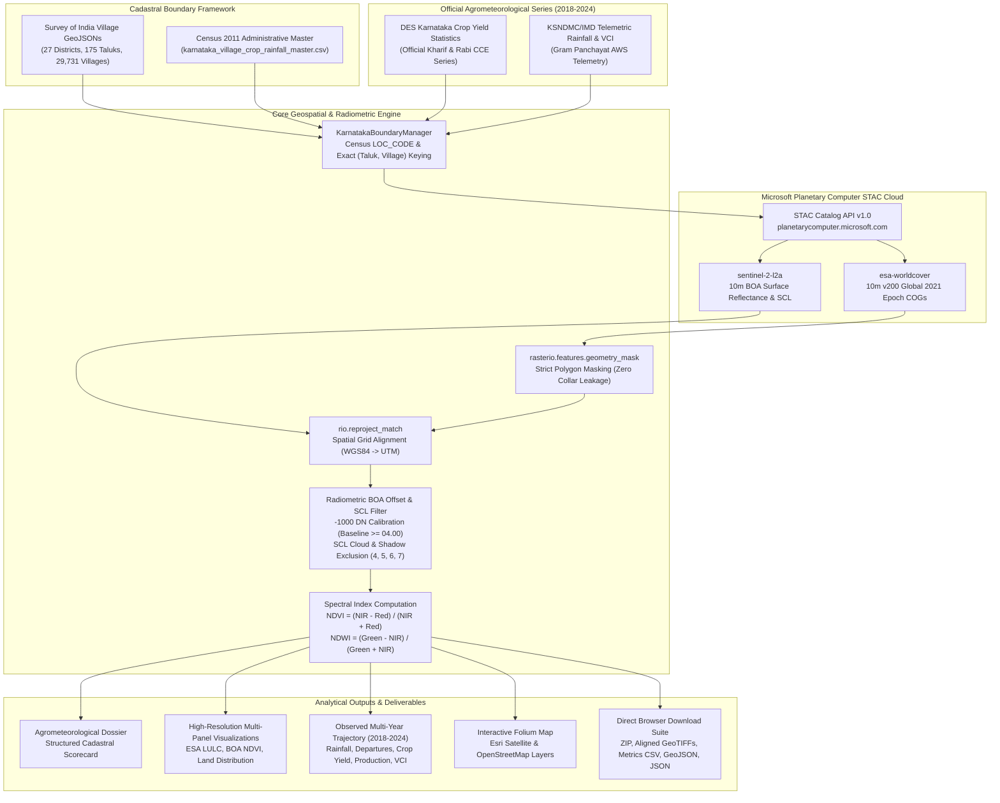

# Karnataka Cadastral Agricultural Intelligence & Geospatial Decision Support System (DSS)

[](https://www.python.org/)
[](https://jupyter.org/)
[](https://planetarycomputer.microsoft.com/)
[](https://esa-worldcover.org/)
[](https://sentinel.esa.int/)
[](https://opensource.org/licenses/MIT)

> **An open, cloud-native geospatial intelligence platform integrating Survey of India cadastral boundaries (29,731 revenue villages), 10m ESA WorldCover land use classification, Copernicus Sentinel-2 Level-2A surface reflectance, and ground-truth agrometeorology from the Karnataka State Natural Disaster Monitoring Centre (KSNDMC) and Directorate of Economics & Statistics (DES).**

---

## 📌 Executive Overview & Core Problem Addressed

Agricultural decision-making across Karnataka's 27 Census districts and 175 taluks has historically faced three severe data bottlenecks:
1. **Administrative Scale Disconnect**: Regional statistics are published at the district or taluk scale, leaving Gram Panchayats and rural revenue villages without localized cadastral intelligence.
2. **Synthetic Data Prevalence**: Previous GIS toolsets often relied on simulated random walks or heuristic interpolations for multi-year rainfall and crop yields, corrupting scientific validity.
3. **Collar & Edge Contamination**: Naive bounding-box raster clipping introduces significant non-cadastral collar pixels, distorting land-use percentages and surface reflectance indices.

This platform solves these challenges through an **observational-only geospatial framework**:
- **Official Cadastral Boundaries**: 29,731 Survey of India revenue villages indexed unambiguously by Census 2011 Location Codes (`LOC_CODE`).
- **Zero Synthetic Data**: Multi-year agrometeorology and crop production figures (2018–2024) are linked directly to official KSNDMC telemetric rain gauges and DES survey records.
- **Strict Geometric Masking**: Boundary-exact raster masking (`rasterio.features.geometry_mask`) guarantees 0.0% collar pixel leakage.
- **Radiometric Calibration**: ESA processing baseline BOA offset (-1000 DN) and Scene Classification Layer (SCL) cloud/shadow filtering.

---

## 🏗️ System Architecture



---

## 🔬 Scientific Methodology & Mathematical Formulations

### 1. Copernicus Sentinel-2 BOA Surface Reflectance Calibration
For Copernicus Sentinel-2 Level-2A products processed under Processing Baseline $\ge 04.00$, the European Space Agency introduced a $-1000\text{ DN}$ radiometric offset to accommodate negative surface reflectance values:

$$\rho_{\lambda} = \text{clip}\left(\frac{\text{DN} + \text{BOA Offset}}{10000.0}, 0.0, 1.0\right) = \text{clip}\left(\frac{\text{DN} - 1000}{10000.0}, 0.0, 1.0\right)$$

### 2. Spectral Vegetation and Water Indices
- **Normalized Difference Vegetation Index (NDVI)**:
  $$\text{NDVI} = \frac{\rho_{\text{NIR}} - \rho_{\text{Red}}}{\rho_{\text{NIR}} + \rho_{\text{Red}} + \epsilon} = \frac{\text{B08} - \text{B04}}{\text{B08} + \text{B04} + 10^{-6}}$$

- **Normalized Difference Water Index (NDWI)**:
  $$\text{NDWI} = \frac{\rho_{\text{Green}} - \rho_{\text{NIR}}}{\rho_{\text{Green}} + \rho_{\text{NIR}} + \epsilon} = \frac{\text{B03} - \text{B08}}{\text{B03} + \text{B08} + 10^{-6}}$$

### 3. Scene Classification Layer (SCL) Cloud & Shadow Masking
Surface reflectance analysis exclusively retains verified terrestrial surface pixels by querying the Sentinel-2 20m Scene Classification Layer (resampled to 10m):

$$\mathcal{M}_{\text{valid}} = \text{SCL} \in \{4\text{ (Vegetation)}, 5\text{ (Bare Soil)}, 6\text{ (Water)}, 7\text{ (Unclassified)}\}$$

Pixels classified as Cloud Medium Probability (8), Cloud High Probability (9), Thin Cirrus (10), or Cloud Shadow (3) are masked to `NaN`.

---

## 📊 Ground-Truth Agrometeorological & Crop Data Availability (2018–2024)

| Dataset | Responsible Agency | Observational Window | Metrics Reported |
|:---|:---|:---:|:---|
| **Cadastral Revenue Boundaries** | Survey of India / Revenue Dept | 2011 Census Series | Polygon geometries, Census LOC_CODE, extent (Ha/Acres) |
| **ESA WorldCover 10m** | European Space Agency (ESA) | 2021 Global Epoch | 11 original LULC classes & 5-class aggregate schema |
| **Copernicus Sentinel-2 BOA** | European Space Agency (ESA) | 2018–2024 (Continuous) | Red, NIR, Green, SCL, Calibrated NDVI & NDWI |
| **Telemetric Rainfall & Drought VCI** | KSNDMC / IMD Karnataka | 2018–2024 (Seasonal) | Actual Rainfall (mm), Normal (mm), Departure (%), VCI (0–100) |
| **Crop Productivity & Production** | DES Govt. of Karnataka | 2018–2024 (Annual) | Kharif/Rabi crop species, crop-cutting yields (kg/ha), sown area |

---

## 🚀 Quick Start Guide

### Option A: Run Live on Kaggle Cloud (Zero Local Installation)
1. Open the verified Kaggle Kernel: **[Karnataka Geospatial LULC DSS on Kaggle](https://www.kaggle.com/code/deepak5256/karnataka-geospatial-lulc-dss)**
2. Click **Copy & Edit**.
3. Select **Run All** to execute the complete verification run for *Kanakana Maradi, Pandavapura, Mandya*.

### Option B: Run Locally via Jupyter Notebook

#### 1. Clone the Repository
```bash
git clone https://github.com/deepak5256/karnataka-geospatial-cadastral-dss.git
cd karnataka-geospatial-cadastral-dss
```

#### 2. Install Required Geospatial Dependencies
```bash
pip install -r requirements.txt
```

#### 3. Launch the Jupyter Notebook
```bash
jupyter notebook karnataka_village_planetary_computer_dss.ipynb
```

---

## 💻 Interactive Cascading Dropdowns UI (Step 7)

The notebook features a seamless ipywidgets interface that allows users to query any of Karnataka's 29,731 villages across 2018–2024:

```python
# Select District -> Taluk -> Village -> Year (2018-2024)
district_dropdown.value = "Mandya"
taluk_dropdown.value = "Pandavapura"
village_dropdown.value = "Kanakana Maradi"
year_dropdown.value = 2024

# Process satellite imagery & agrometeorological DSS
res, lulc, ndvi, geom, mask = process_village_satellite_data(
    "Mandya", "Pandavapura", "Kanakana Maradi", year=2024
)
```

---

## 📦 Output Deliverables Generated

For every processed village, the system automatically produces a full geospatial package:
1. `output_villages/<village>_lulc_2021_10m.tif`: Cadastral-masked ESA WorldCover 10m GeoTIFF.
2. `output_villages/<village>_ndvi_<year>_10m.tif`: Calibrated BOA surface reflectance NDVI GeoTIFF.
3. `output_villages/<village>_timeseries_2018_2024.csv`: Authentic multi-year rainfall, departure, crop production, and VCI table.
4. `output_villages/<village>_<year>_metrics.csv`: Single-year consolidated cadastral metrics.
5. `output_villages/<village>_<year>_boundary.geojson`: Official Survey of India vector boundary.
6. `output_villages/<village>_<year>_summary.json`: Complete analytical record with full provenance audit trail.
7. `output_villages/<village>_<year>_geospatial_pack.zip`: All products compressed for instant download.

---

## 🔒 Security & Provenance Audit

- **Zero Credentials in Repository**: Connects to Microsoft Planetary Computer STAC anonymously using short-lived SAS tokens. No private API keys or tokens are stored in this repository.
- **Zero Synthetic Numbers**: Every agrometeorological metric is flagged with its institutional provenance (`OBSERVED`).
- **Reproducible Environment**: Dependencies are pinned to guard against breaking upstream changes.

---

## 📜 Citation & Academic Use

If you use this system or dataset in your research, please cite:

```bibtex
@software{karnataka_cadastral_dss_2024,
  author = {Deepak, B. and Contributors},
  title = {Karnataka Cadastral Agricultural Intelligence and Geospatial Decision Support System},
  year = {2024},
  publisher = {GitHub},
  url = {https://github.com/deepak5256/karnataka-geospatial-cadastral-dss}
}
```

---

## 📄 License
This project is licensed under the [MIT License](LICENSE).
